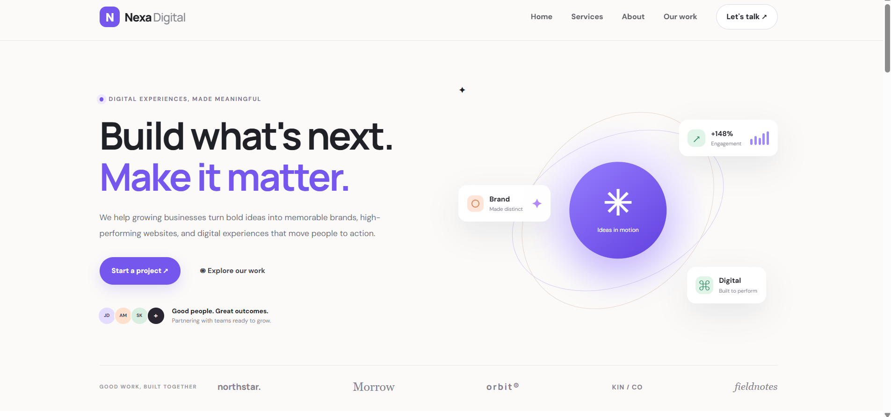
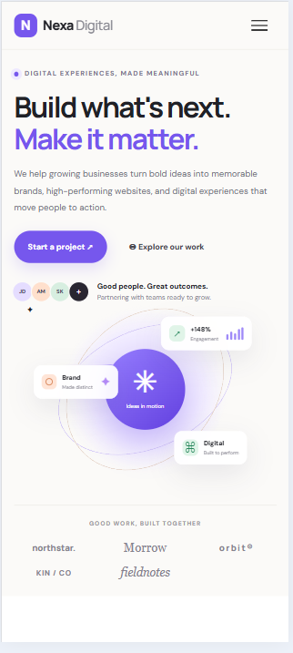
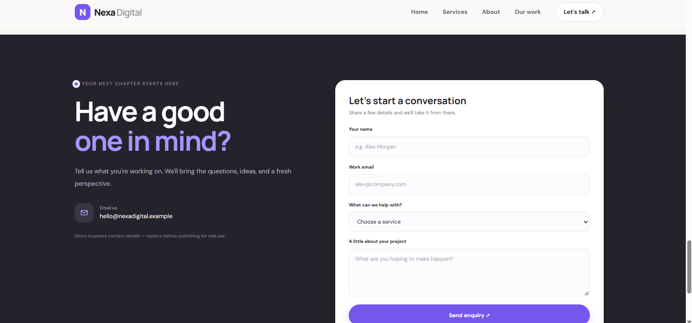

Nexa Digital – Responsive Business Landing Page

1. Project Title
   Nexa Digital – Responsive Business Landing Page
   
   A modern, responsive landing page for a digital agency, designed to showcase services, communicate business value, and encourage visitors to get in touch.

2. Objective
   The objective of this project is to build a professional business landing page using HTML, CSS, and JavaScript. The website demonstrates responsive design, consistent branding, clear navigation, service presentation, and an accessible contact form across desktop and mobile devices.

3. Tech Stack
   - HTML5 – Website structure, content, navigation, and contact form.
   - CSS3 – Styling, responsive layouts, typography, animations, and visual effects.
   - JavaScript – Interactive elements and optional form validation.

4. Features Implemented

   Navigation Bar
   - Business name and branding.
   - Navigation links to key website sections.
   - Primary call-to-action button.
   - Responsive navigation for smaller screens.
   
   Hero Section
   - Headline communicating the business value proposition.
   - Supporting description.
   - Primary and secondary call-to-action buttons.
   - Hero image or background visual.
   - Professional layout and typography.
   
   Services Section
   - Service cards presenting business offerings.
   - Consistent spacing, alignment, and card styling.
   - Short descriptions explaining the value of each service.
   - Icons or images where appropriate.
   
   About Section
   - Introduction to the business.
   - Information about its services and value.
   - Brand-consistent presentation.
   
   Contact Form
   - Name field.
   - Email field.
   - Phone field or optional business-specific field.
   - Message textarea.
   - Submit button.
   - Basic form validation using HTML attributes.
   
   Responsive Design and Styling
   - Responsive layouts for desktop, tablet, and mobile devices.
   - Mobile-friendly design for screens below 768px.
   - Readable typography and balanced spacing.
   - Proportional image scaling.
   - Consistent button styles, border radius, and visual effects.
   - Interactive hover effects and animations where appropriate.

5. Folder Structure
   business-landing-page/
   ├── index.html
   ├── css/
   │   └── style.css
   ├── js/
   │   └── script.js
   ├── screenshots/
   │   ├── desktop-full-page.png
   │   ├── hero-mobile.png
   │   ├── services-section.png
   │   └── contact-form.png
   └── README.md

6. Setup and Run Instructions

   1. Clone or download the repository:
   git clone https://github.com/gajendrapise90-source/week1-assignments.git 
   2. Open the project folder in Visual Studio Code or another code editor.
   3. Open `index.html` in a web browser.
   4. Test the navigation links, call-to-action buttons, service cards, and contact form.
   5. Resize the browser window or use Developer Tools to verify responsiveness on mobile devices.
   
   No additional dependencies are required for the basic HTML, CSS, and JavaScript implementation.

7. Live Project Link

   Live Demo: https://gajendrapise90-source.github.io/week1-assignments/business-landing-page


8. Screenshots

   Add screenshots of the completed landing page to `screenshots/`.
   
    Required Screenshots
   1. Full Desktop View – Shows the complete landing page layout.
   2. Mobile Hero Section – Demonstrates responsive hero content and navigation.
   3. Services Section – Shows the service cards and their layout.
   4. Contact Form – Shows the form fields and submit button.
   
   To display screenshots in this README, use Markdown:
   
   ```markdown
   
   
   
   
   
   
   
   ```

 9. Industry Best Practices
   - Maintained consistent branding and visual styling.
   - Used clear heading and body-text hierarchy.
   - Placed important messaging and calls to action prominently.
   - Organized sections in a logical order.
   - Used readable text contrast and sufficient whitespace.
   - Designed touch-friendly buttons and form fields.
   - Implemented responsive behavior for smaller screens.
   - Used semantic HTML elements where appropriate.

 10. Author Details
   - Name: Gajendra Lomeshrao Pise
   - GitHub: https://github.com/gajendrapise90-source
   - LinkedIn: https://www.linkedin.com/in/gajendra-pise-41830b370/

 11. Project Information
   - Program: WeIntern Internship
   - Week: Week 1
   - Task: Task 2 – Responsive Business Landing Page
   - Business Concept: Nexa Digital – Digital Agency

---
