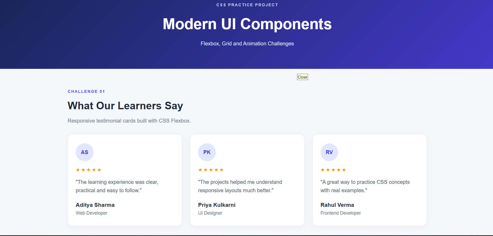
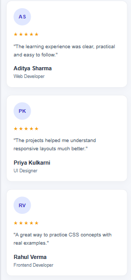
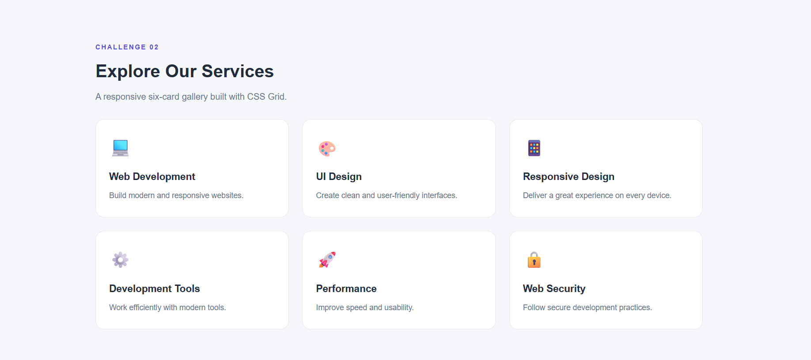
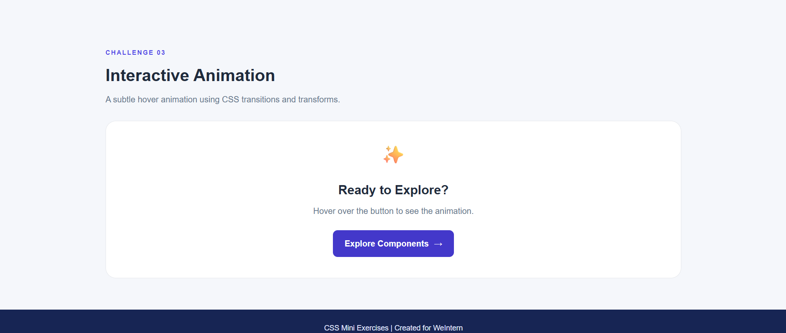

CSS Challenge – Responsive Layouts and Animations

1. Project Title
   CSS Challenge: Flexbox, Grid Layout, and CSS Animations

2. Objective
   The objective of this project is to strengthen practical CSS skills by creating responsive layouts and interactive components using Flexbox, CSS Grid, and animations. The project demonstrates responsive design, consistent spacing, alignment, and smooth visual effects across desktop and mobile devices.

3. Tech Stack
   - HTML5 – Structure and content of the components.
   - CSS3 – Flexbox, Grid, responsive layouts, transitions, transforms, and  animations.
   - JavaScript – Optional, if used for additional interactions.

4. Features Implemented

   A. Flexbox Layout Task
   - Three testimonial or feature cards displayed in a horizontal row on desktop.
   - Cards arranged vertically on smaller screens.
   - Proper alignment using `justify-content` and `align-items`.
   - Consistent spacing using `gap`.
   - Flexible card widths for responsive layouts.
   - Hover effects for interactive feedback.
   
   B. Grid Layout Task
   - Gallery or dashboard-style layout with at least six grid items.
   - Responsive columns defined using `repeat()` and flexible sizing.
   - Consistent card styling, spacing, and alignment.
   - Responsive rearrangement at smaller screen sizes.
   
   C. Animation Task
   - Smooth and subtle CSS animation or interaction effect.
   - Use of `transition`, `transform`, or `@keyframes`.
   - Animation options include button hover effects, loading spinners, fade-in reveals, card lift effects, or animated navigation underlines.
   - Animations designed to enhance usability without excessive motion.

5. Folder Structure
   
   css-challenge/
   ├── index.html
   ├── css/
   │   └── style.css
   ├── screenshots/
   │   ├── flexbox-desktop.png
   │   ├── flexbox-mobile.png
   │   ├── grid-layout.png
   │   └── animation-example.png
   └── README.md
   
7. Setup and Run Instructions
   1. Clone or download the repository:
      git clone https://github.com/gajendrapise90-source/week1-assignments.git
   2. Open the project folder in Visual Studio Code or another code editor.
   3. Open `index.html` in a web browser.
   4. Test the Flexbox layout, Grid layout, and animation effects.
   5. Resize the browser window or use Developer Tools to verify the responsive behavior on desktop and mobile screens.

   No additional dependencies are required.

8. Live Project Link
   
   Live Demo: https://gajendrapise90-source.github.io/week1-assignments/css-challenge


9. Screenshots

   Add screenshots of the completed CSS Challenge project to `screenshots/`.
   
   Required Screenshots
   
   1. Flexbox Desktop View – Shows three cards displayed horizontally on desktop.
   2. Flexbox Mobile View – Demonstrates cards stacked vertically on mobile.
   3. Grid Layout – Shows a responsive grid layout containing at least six items.
   4. Animation Example – Demonstrates a CSS animation or hover effect.
   
   To display screenshots in this README, use Markdown:
   
   ```markdown
   
   
   
   
   
   
   
   ```
 9.Industry Best Practices
   - Used clear and meaningful CSS class names.
   - Organized components into logical sections.
   - Maintained consistent spacing and alignment.
   - Used responsive CSS media queries.
   - Avoided unnecessary absolute positioning.
   - Tested layouts using browser Developer Tools.
   - Kept animations smooth and subtle.

10. Author Details
   - Name: Gajendra Lomeshrao Pise
   - GitHub: https://github.com/gajendrapise90-source
   - LinkedIn: https://www.linkedin.com/in/gajendra-pise-41830b370/


11. Project Information
   - Program: WeIntern Internship
   - Week: Week 1
   - Task: Task 3 – CSS Challenge

---
